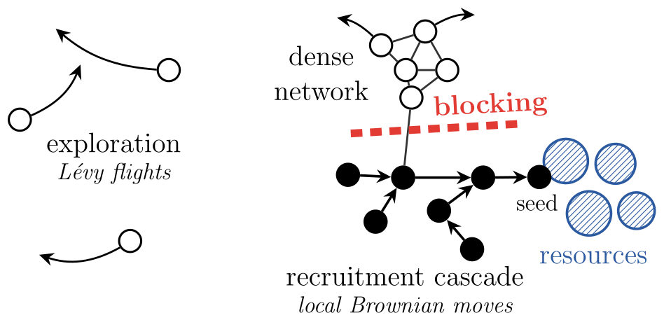
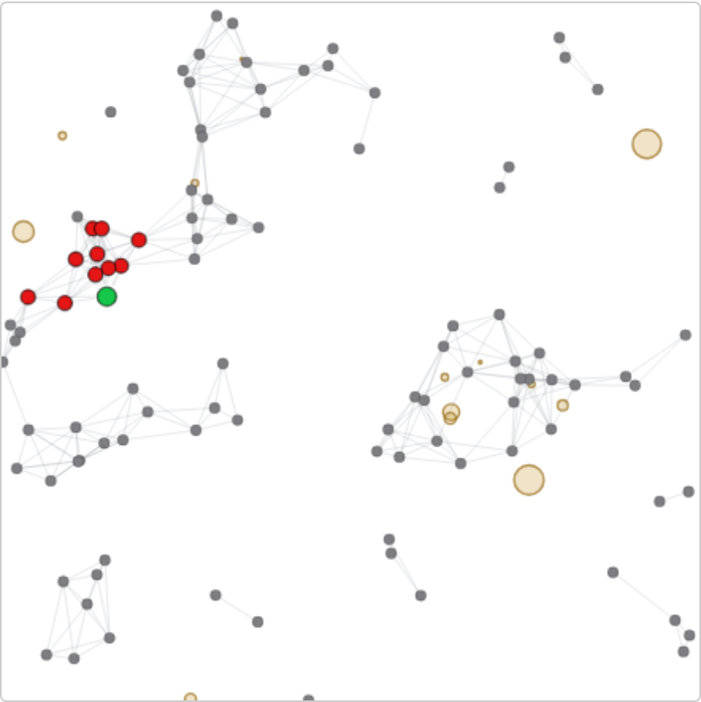

# A learner-free, self-organizing swarm approaches reinforcement learning's explore–exploit optimum

Code and manuscript for the paper *"A learner-free, self-organizing swarm approaches reinforcement
learning's explore–exploit optimum."*

A minimal foraging swarm — Lévy exploration + a threshold recruitment cascade on the proximity graph +
density-dependent dispersal — self-organizes to the ideal-free / Nash-equilibrium allocation of a multi-agent
habitat-selection (congestion) explore/exploit problem, with **no learner, no reward signal, and no training**.
The swarm reaches the *shape* of the optimum (not the exact equilibrium), does so by reaching rather than
learning, and — measured against a validated oracle ceiling in a shared embodied environment — is competitive
with an online decentralized RL learner at none of its overhead.

## The idea, in one picture



The swarm is solving a **multi-armed bandit** — a spatial, embodied one. Each resource patch is an *arm* whose
**state must be discovered**: unlike a textbook bandit with fixed, labelled arms, here an arm's existence, its
**location, and its size (richness) are unknown** and have to be found by searching, and its payoff *per
forager* **drops as more foragers crowd onto it** (a congestion bandit). So the swarm must both *explore* —
Lévy flights, to find the patches — and *exploit* — recruit neighbours to a discovery, then disperse as it
crowds.

The surprise: it reaches this bandit's optimum with **none of reinforcement learning's machinery** — no
learner, no value function, no training, no reward signal in the loop. The self-organizing
explore → recruit → disperse cycle settles at the **ideal-free / Nash allocation** (foragers in proportion to
patch richness), which *is* the bandit's optimal allocation — reached *approximately*, and by *reaching* rather
than *learning* (see the paper for the precise, calibrated claims).

## Interactive demo

**Run it live in your browser:**
[**galenwilkerson.github.io/collective_foraging_demo_rl.html**](https://galenwilkerson.github.io/collective_foraging_demo_rl.html)
— this paper's reward-free / learner-free swarm, no install. (The source is also bundled here in
[`demos/collective_foraging_demo.html`](demos/collective_foraging_demo.html).)

<a href="https://galenwilkerson.github.io/collective_foraging_demo_rl.html"></a>

*The swarm window: grey agents linked by the proximity graph, a green discovery (seed) triggering a red
recruitment cascade; agents disperse as resource patches (tan) crowd.*

## Repository layout

This repository is **self-contained**: a fresh clone can regenerate every data-driven figure in the paper
without any external path or download.

```
main.tex, refs.bib        manuscript source (TMLR format; anonymized for double-blind review)
main.pdf                  compiled manuscript
requirements.txt          Python dependencies (numpy, torch, matplotlib, scipy)
figures/                  paper figures (*.pdf/*.png) + their self-contained generators gen_*.py
code/                     bundled CPU simulation code
    mobile_cascade.py       the mobile recruitment-cascade foraging model
    batched_swarm.py        batched swarm primitives (mobile_cascade imports select_device from here)
step3_gpu/                embodied swarm-vs-RL training + analysis code (GPU for training, CPU for analysis)
    torch_env.py, policies_batched.py
    train_gpu.py, train_long.py, train_mappo.py, train_robust.py
    analyze_step3_gpu.py
data/                     small bundled caches the figure scripts read (so figures reproduce with no GPU)
    step3_gpu/              step3_gpu_long.npz, step3_gpu_mappo.npz   (IPPO/GNN + MAPPO eval results)
    dimensionless_sweep/    sweep_v1.npz                              (1024-pt Sobol robustness sweep)
    paper2_convergence/     convergence_B64_T800_seed0.npz           (per-tick occupancy cache)
    paper2_bridge/          bridge_B64_T800_seed0.npz                (recruitment inflow/release cache)
    paper2_marl/            marl_results_steps4000_seed0.npz          (trained congestion-game learners)
    paper2_selforg/         b1_B48_T600.npz                          (connectivity sweep cache)
    paper2_discrim/         exp3_plateau_B64_T800.npz                (information-plateau cache)
```

Each figure generator resolves its paths **repo-relative first**, falling back to the authors' original
absolute scratch paths only if the bundled `code/` or `data/` directories are absent — so cloning "just
works" while the authors' local workflow is unchanged.

## Reproducing the paper's figures

**Quick start** — regenerate every figure from the bundled `data/` (CPU only):

```
pip install -r requirements.txt
bash reproduce.sh
```

Or run the generators individually:

```
pip install -r requirements.txt
cd figures
```

Every data-driven figure in the paper regenerates from the bundled `data/` caches (CPU only, no GPU, seconds
to a few minutes each):

| Script | Paper figure(s) | Reads |
|---|---|---|
| `gen_stronger_f1.py`      | `fig_stronger`        | `data/step3_gpu/` |
| `gen_learning_curves.py`  | `fig_learning_curves` | `data/step3_gpu/` |
| `gen_robustness_sweep.py` | `fig_robustness`      | `data/dimensionless_sweep/sweep_v1.npz` |
| `gen_ifd_fig_b64.py`      | `fig_ifd`             | `data/paper2_convergence/` |
| `gen_convergence_fig.py`  | `fig_convergence`     | `data/paper2_convergence/` (else re-simulates via `code/`) |
| `gen_b1_selforg.py`       | `fig_b1_selforg`      | `data/paper2_selforg/` (else re-simulates via `code/`) |
| `gen_discrim_exp3.py`     | `fig_discrim_plateau` | `data/paper2_discrim/` (else re-simulates via `code/`) |
| `gen_bridge_figs.py`      | `fig_recruit_vs_payoff` | `data/paper2_bridge/` (else re-simulates via `code/`) |
| `gen_marl_figs.py`        | `fig_marl_compare`, `fig_marl_regimes` | `data/paper2_marl/` + `data/paper2_bridge/` |

```
python3 gen_stronger_f1.py        # and so on for each script above
```

(`fig_mechanism_tikz` and `fig_cycle_schematic_tikz` are drawn in TikZ and are produced by the LaTeX build,
not by a Python script.)

The four scripts marked *"else re-simulates via `code/`"* are self-regenerating: if their bundled cache is
present they load it; delete it (or run with `FORCE=1`) and they re-run the CPU simulation in `code/` to
rebuild it. All of this is CPU-only.

## Regenerating the data from scratch

- **CPU caches** (`paper2_*`, `dimensionless_sweep`): produced by the self-regenerating figure scripts above
  (`FORCE=1 python3 gen_<name>.py`), or by the drivers under the corresponding experiment directories.
- **GPU training caches** (`data/step3_gpu/step3_gpu_long.npz`, `step3_gpu_mappo.npz`): produced by the
  training scripts in `step3_gpu/` and **require a GPU** (the embodied IPPO / GNN / MAPPO learners):

  ```
  cd step3_gpu
  python3 train_long.py        # IPPO + GNN embodied learners -> step3_gpu_long.npz
  python3 train_mappo.py       # centralized-critic MAPPO steelman -> step3_gpu_mappo.npz
  # analysis / headline (CPU):
  python3 analyze_step3_gpu.py
  ```

  The training scripts write to `data/step3_gpu/` by default; set the `FLOCKING_DATA` environment variable to
  redirect the output directory. `train_long.py`/`train_mappo.py` provide the two npz files the paper's
  `fig_stronger` and `fig_learning_curves` consume — both are already bundled under `data/step3_gpu/`, so a GPU
  is **not** needed just to reproduce the figures.

## Companion paper

The underlying self-organized-critical mechanism (the cascade window; movement-neutral recruitment) is
developed in a companion paper (Part I).

## License

MIT — see `LICENSE`.
</content>
</invoke>
